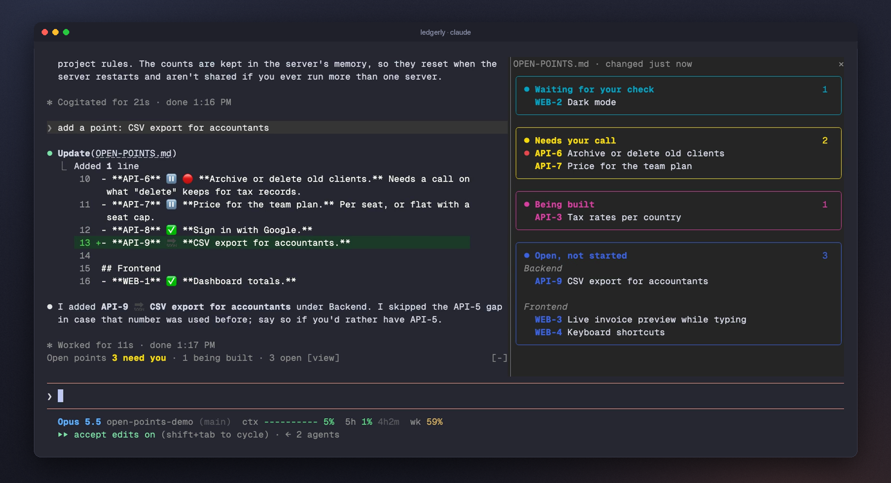
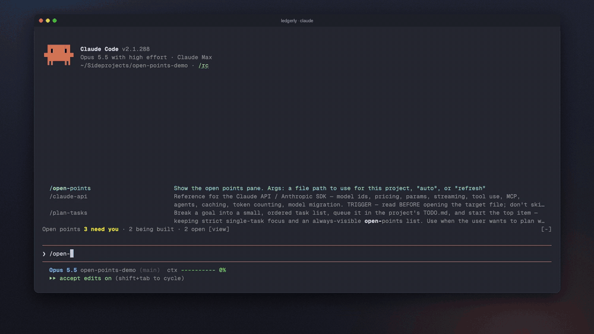

# Claude Open Points

A Claude Code mod that keeps your project's to-do list in view. A pane beside the chat groups your open points by status, a line above the prompt counts what needs you, and both update the moment Claude edits the list.

[](LICENSE)



## Install

Inside Claude Code, run:

```
/plugin marketplace add rightlabs/claude-open-points
/plugin install open-points
/reload-plugins
```

Then type `/open-points` to open the pane.

<details>
<summary><strong>Prefer the terminal?</strong></summary>

```bash
claude plugin marketplace add rightlabs/claude-open-points
claude plugin install open-points@claude-open-points
```

Then run `/reload-plugins` inside a session, or start a new one.

</details>

## What you see

```
Open points 3 need you · 1 being built · 3 open [view]
```

- **A line above the prompt** with what needs you, what is being built and what is open. Always there, in every session of the project.
- **A pane** (`/open-points`) with one coloured box per status: waiting for your check, needs your call, being built, open. Points are split by the `##` sections of your file. Later, Done and Dropped fold into one line at the bottom.
- **Live.** It rereads the file every 2 seconds and right after Claude edits it, so when Claude finishes a point and marks it, the point moves on its own.
- **Press a point** to put its id into the prompt, ready for "build WEB-3".

## See it work

Claude builds a point, marks it done, and the pane moves it without anyone touching the file:



## Your list

Any markdown list works. With no setup it looks in the project for `OPEN-POINTS.md`, `TODO.md`, `TO-DO.md` or `TASKS.md` (upper or lower case), then the same names under `docs/`. To pick a file, run `/open-points path/to/list.md` (remembered per project) and `/open-points auto` to go back.

A point is a top-level list line. Its status comes from the first of these that it has:

| | Done | Your check | Your call | Being built | Dropped |
|---|---|---|---|---|---|
| Checkbox | `[x]` | | `[?]` `[!]` | `[~]` `[/]` | `[-]` |
| Emoji | ✅ ✔ ✓ | 🔎 👀 | ⏸️ ❓ 🚫 | 🔨 ⏳ 🚧 | ❌ ➡️ |
| Leading word | DONE, CLOSED | AWAITING ... CHECK, REVIEW | BLOCKED, FINDING | WIP, DOING | DROPPED, MERGED |
| Heading | Done, Completed | Review | Blocked, Questions | Now, In progress | Dropped |

Points under a heading named Backlog, Later, Parked, Someday, Ideas or Post-live, and `[>]` / `[<]` tasks, go to **Later**. 🔴, 🔥 or ⏫ marks a point urgent.

An id at the start of a point is picked up when it is bold or bracketed (`**R7**`, `[R7]`), hyphenated (`API-4`), an issue number (`#42`) or followed by a colon (`R7:`). When most points have one, unmarked lines without one are treated as notes.

Also handled: numbered lists, Obsidian Tasks dates and priorities (`📅 2026-10-05 ⏫`), checkbox tasks nested under a plain project bullet (the bullet becomes their group), YAML front matter, HTML comments, code blocks and Windows line endings. Other nested lines are details of their point and are not listed.

Both of these work:

```markdown
## Backend
- **API-4** 🔨 **Rate limits on the public API.** 100 requests a minute per key.
- **API-6** ⏸️ 🔴 **Archive or delete old clients.**
```

```markdown
## Now
- [ ] Build the invoice preview
## Done
- [x] Sign in with Google
```

A line in your project's `CLAUDE.md` makes Claude keep the list for you:

```markdown
When you finish a point, change its status emoji to ✅ in OPEN-POINTS.md.
```

## Settings

In `/config`, under open-points:

- `file`: one path for every project (empty finds it by itself).
- `showBand`: the line above the prompt (on by default).
- `openPaneOnStart`: open the pane when a session starts (off by default).

## Privacy

The mod reads your list file and nothing else. It makes no network calls, runs no programs, never writes to your files and never calls the model. The only thing it keeps is which file you picked with `/open-points <path>`, stored per project in Claude Code's local plugin store on your machine.

## Notes

- Mods are an early-access part of Claude Code. Built and tested on Claude Code 2.1.288.
- The pane docks beside the chat in the fullscreen layout; elsewhere it opens above the prompt.

## License

MIT
